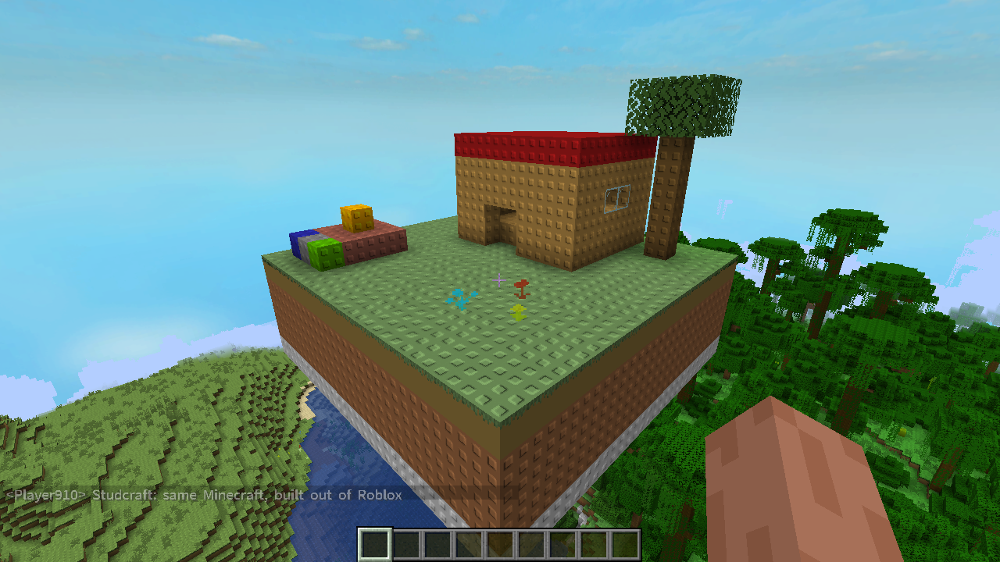
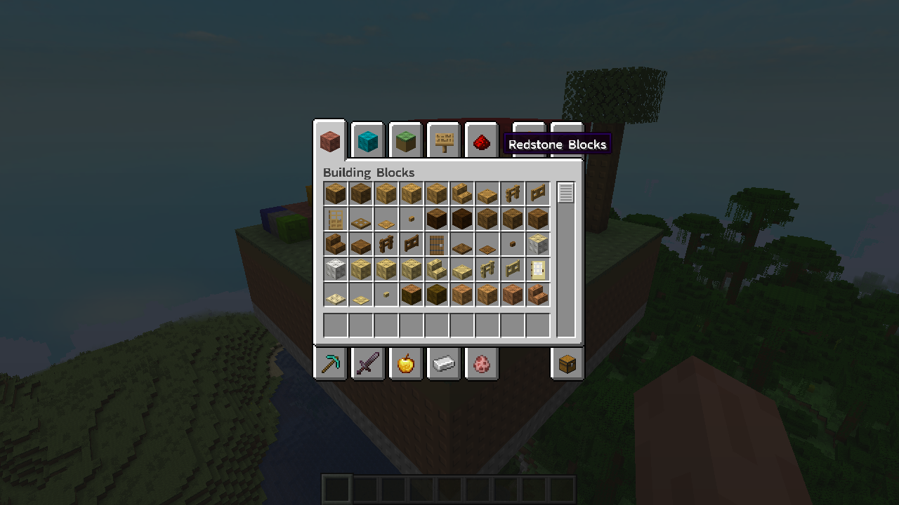

# Studcraft

**Minecraft, built out of Roblox.** You're still Steve, with Minecraft's own block menu, but the world
is made of Roblox's studded plastic parts under Roblox's sky.

Minecraft: Java Edition 1.21.1 (Fabric) is the game you play. Roblox brings its own content in from
**your own Roblox install** while you play. Nothing from Roblox or Minecraft is copied into this mod
or its download.



## What you get
- **Studded plastic blocks.** Each block's colour becomes a Roblox part made from Roblox's own
  `studs.dds`: studs on top, inlets underneath, smooth sides. Single-texture blocks (stone, dirt,
  planks) are studded all over. Flowers, leaves and glass keep their shape in flat plastic colour.
- **Roblox's sky, sun and moon.** Roblox's default skybox (`sky512_*`) replaces the Overworld sky, and
  Minecraft's blocky clouds are hidden. The sun and moon are Roblox's `sun.jpg` and `moon.jpg`.
  The sky darkens at night, and stars still come out.
- **Roblox's font.** All text uses Roblox's Source Sans (`SourceSansPro-Semibold.ttf`): chat, menus
  and the block menu.
- **The oof.** Getting hurt or dying plays Roblox's `oof.ogg`.
- **Still Minecraft.** You keep Steve (or your own skin), the creative block menu, survival,
  crafting, mobs and worlds. Single player.



## How it finds Roblox
In order:
1. `STUDCRAFT_ROBLOX_DIR` (the Melty recipe sets this to `{game:roblox}`).
2. `%LOCALAPPDATA%\Roblox\Versions`.
3. The same folder under Bloxstrap, Fishstrap or Voidstrap.
4. `Program Files\Roblox`.

It picks the newest version folder that holds `PlatformContent/pc/textures/studs.dds`. Without Roblox,
Minecraft stays vanilla and the log says so.

## Melty test mode
When Melty tests a release (`%LOCALAPPDATA%\Melty\test\studcraft.json` exists), the mod makes a fresh
creative world from the test seed, sets noon and reports `roblox-found`, `studs-applied`, `roblox-sky`,
`roblox-font` and `roblox-oof` (the `test_checks` sheet) through Melty's own `MeltyTest.java`. In a
player's game it does nothing.

## Layout
| Path | What |
|---|---|
| `sheets/*.json` | Design sheets, the source of truth: Roblox files read, block styles, sky faces, asset overrides, game hooks |
| `tools/sheets.py` | `preflight` checks every cell and cross-sheet reference; `generate` writes `Sheets.java` from the rows |
| `mod/` | Fabric mod (Mojang mappings, Loom 1.11.8, Minecraft 1.21.1, Fabric Loader 0.16.14). No Fabric API needed |
| `packaging/` | `package.sh` (builds the release jar) and `melty-recipe.json` (the validated Melty install recipe) |
| `media/` | Screenshots of this version running |

## Build
```
python3 tools/sheets.py generate     # after editing a sheet
cd mod && ./gradlew build             # mod jar in mod/build/libs
./packaging/package.sh                # dist/studcraft-<version>.jar, the release Melty installs
```

## Credits
Mod by agoodclanker, built with Claude Code. Melty brings Prism Launcher, Java, Minecraft 1.21.1 and
Fabric Loader; the release is just the mod jar. Minecraft is a trademark of Mojang/Microsoft and Roblox of Roblox
Corporation; this project is not affiliated with either.
